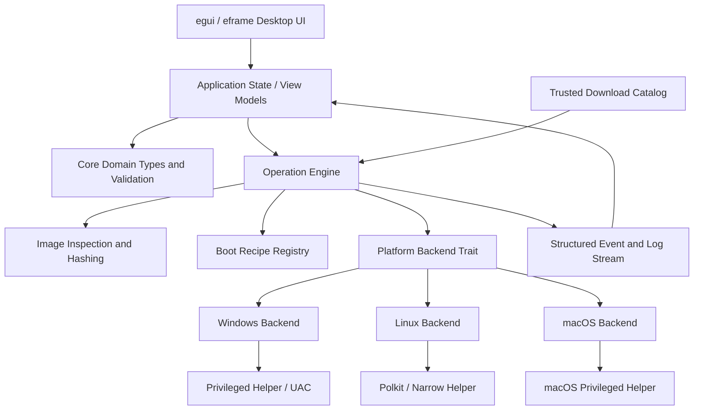

# USB X — Architecture

## 1. High-level design

The desktop UI is implemented in Rust using **egui + eframe**. UI code owns presentation and interaction only; it never performs raw disk I/O.

Use a Rust workspace with a thin desktop application, a platform-neutral operation engine, platform-specific device backends, and a narrowly scoped privileged helper. The UI does not directly perform block-device operations.



## 2. Architectural boundaries

### UI layer

Responsibilities: render the form, collect validated input, show device summaries, display progress/log events, and request confirmation. It does not enumerate raw devices or construct shell commands.

### Application layer

Responsibilities: own screen state, coordinate refresh and operation lifecycles, translate user selections into typed requests, disable conflicting controls, and forward events to the UI.

### Core domain layer

Contains stable domain types and validation rules:

- `DeviceId` — opaque, platform-specific identity token.
- `DeviceInfo` — model, size, connection type, removable status, partition summaries, system-disk risk.
- `ImageInfo` — path, byte length, detected format/OS/architecture, hash state, boot metadata confidence.
- `PartitionScheme` — Auto, MBR, GPT.
- `BootMode` — Auto, LegacyBios, Uefi, BiosAndUefi.
- `FileSystem` — Fat32, Ntfs, ExFat, Udf.
- `OperationPlan` — validated immutable description of the requested action.
- `OperationEvent` — typed progress, warning, log, cancellation, and completion events.
- `CapabilitySet` — operations and formats supported by the active host backend.

Use validated newtypes for bytes, offsets, block sizes, percentage ranges, and identifiers. Do not store a device locator string as the identity.

### Operation engine

Responsible for orchestration, preflight validation, streaming I/O, stage transitions, retry policy, cancellation semantics, flush, and verification. It should be deterministic and testable with a mock backend.

### Platform backend

Exposes a small, typed interface. Example conceptual operations:

```rust
trait PlatformStorage {
    fn enumerate_devices(&self) -> Result<Vec<DeviceInfo>, StorageError>;
    fn revalidate(&self, id: &DeviceId) -> Result<DeviceInfo, StorageError>;
    fn unmount_all(&self, id: &DeviceId) -> Result<(), StorageError>;
    fn lock(&self, id: &DeviceId) -> Result<DeviceGuard, StorageError>;
    fn read_at(&self, id: &DeviceId, offset: u64, buffer: &mut [u8]) -> Result<usize, StorageError>;
    fn write_at(&self, id: &DeviceId, offset: u64, buffer: &[u8]) -> Result<usize, StorageError>;
    fn flush(&self, id: &DeviceId) -> Result<(), StorageError>;
    fn create_layout(&self, id: &DeviceId, layout: &ValidatedLayout) -> Result<(), StorageError>;
    fn format_volume(&self, volume: &VolumeId, options: &FormatOptions) -> Result<(), StorageError>;
    fn eject(&self, id: &DeviceId) -> Result<(), StorageError>;
}
```

This is illustrative, not a ready-to-compile interface: adapt ownership, async/blocking behavior, and guard lifetime to each OS. The safety contract is more important than these exact method names.

### Privileged helper

The helper is a small, signed, separately executable component that performs only the requested privileged storage operation. It must:

- Accept a versioned, typed request protocol over a local IPC channel.
- Validate operation type, target identity, range, length, and options independently.
- Revalidate the device on the privileged side.
- Refuse arbitrary command execution and arbitrary file-system paths.
- Return typed events/results and bounded diagnostic output.
- Close/unload or return to idle after the operation. No always-on network listener.

On Windows, use UAC elevation for the helper or the minimum privileged process required. On Linux, use a polkit-authorized helper or an existing storage service where appropriate. On macOS, use a documented privileged-helper mechanism. Never run the whole UI as root/Administrator merely to simplify development.

## 3. Operation models

### Format-only

1. Validate target and platform capability.
2. Require confirmation.
3. Revalidate stable target ID and capacity.
4. Unmount/lock target.
5. Create partition table and partition layout.
6. Format selected volume.
7. Re-enumerate and validate file system/label/capacity.
8. Flush, release lock, optionally eject, report result.

### Raw image write

1. Inspect source file and compute/verify requested hashes.
2. Validate target capacity and source/image compatibility.
3. Show review summary and require confirmation.
4. Revalidate target identity and acquire lock.
5. Stream source to target in bounded chunks; report bytes and rate.
6. Flush device.
7. Read back source range (full or sampled mode must be labelled accurately) and compare hashes.
8. Flush/release/eject and report success only after all required checks pass.

### Prepared Windows installer

1. Identify supported Windows ISO and build number/architecture where detectable.
2. Inspect file tree and determine whether `install.wim` exceeds FAT32's maximum single-file size.
3. Create a temporary working directory and copy/extract files.
4. Select one supported recipe: FAT32 with split WIM, or tested NTFS/UEFI bridge profile.
5. If requested, generate an answer file from versioned templates and preview its contents.
6. Validate that the selected boot chain and file system meet the requested firmware mode.
7. Create partition layout, copy files, install only the recipe's reviewed boot files, and verify the result.
8. Clean temporary data and record a recipe/version ID in the log.

### Backup

1. Identify/lock source device and calculate exact addressable byte range.
2. Create destination file using safe exclusive-create semantics.
3. Stream raw sectors, optionally compress the stream, update hash and progress.
4. Flush file and parent directory where supported.
5. Write a manifest and verify the backup hash.
6. Do not modify source device.

### Restore

1. Validate backup manifest and compute/verify backup hash.
2. Compare source image length and target capacity.
3. Require explicit typed confirmation naming the target.
4. Revalidate/lock target.
5. Stream image to target; define and test behavior for target larger than image (remaining bytes are not automatically wiped unless the user explicitly chooses that option).
6. Flush and read back verification.

### Flash-capacity test

- The read-only scan and destructive write/read test are separate operation types.
- The destructive path writes deterministic pseudorandom test blocks and verifies exact data on read-back.
- Persist the test seed and block map in a local result file so an interrupted test is not mistaken for a completed test.
- No automatic partition correction or data recovery action is allowed.

## 4. Image recipe registry

Use a data-driven but code-reviewed registry. Each recipe should specify:

- Supported OS/distribution and versions.
- Supported architecture.
- Source detection rules and confidence level.
- Partition scheme(s), file system(s), and boot modes.
- Whether it preserves the source image byte-for-byte or extracts/customizes files.
- EFI/BIOS boot components and signature provenance.
- Secure Boot status and limitations.
- Persistence compatibility if applicable.
- Tests and known-good fixture identifiers.

Do not let a downloaded remote catalog inject arbitrary scripts, executable code, bootloader binaries, or commands. Remote catalog data can provide metadata and verified download pointers, not new executable behavior.

## 5. Progress/event contract

Use structured events such as:

```rust
pub enum OperationEvent {
    StageChanged { stage: OperationStage, message: String },
    Progress { completed_bytes: u64, total_bytes: Option<u64>, bytes_per_second: Option<u64> },
    Log { level: LogLevel, code: String, message: String },
    Warning { code: String, message: String },
    CancellationBoundary { safe_to_cancel: bool },
    Finished { result: OperationResult },
}
```

Do not publish a fabricated percentage. When the stage is not byte-based, use a stage indicator or indeterminate progress. Calculate ETA from a smoothed recent throughput estimate and omit it when unreliable.

## 6. Suggested repository layout

```text
usb-x/
├── Cargo.toml                 # Workspace
├── README.md
├── PROJECT_RULES.md
├── docs/
│   ├── PRODUCT_REQUIREMENTS.md
│   ├── UI_SPEC.md
│   ├── ARCHITECTURE.md
│   ├── TECH_STACK.md
│   ├── SECURITY_AND_DATA_SAFETY.md
│   ├── ROADMAP.md
│   ├── BUILD_AND_RELEASE.md
│   └── TEST_PLAN.md
├── crates/
│   ├── usb-x-core/             # Domain types, validation, errors
│   ├── usb-x-engine/           # Operations, streaming, progress
│   ├── usb-x-platform/         # Backend traits + OS adapters
│   ├── usb-x-image/            # Image probing, hashing, WIM helpers
│   ├── usb-x-recipes/          # Reviewed, versioned boot recipes
│   ├── usb-x-catalog/          # Official source metadata/downloads
│   ├── usb-x-helper/           # Privileged helper executable/protocol
│   └── usb-x-app/              # egui/eframe application and view models
├── assets/
├── tests/
│   ├── fixtures/
│   ├── mock-device/
│   └── hardware/               # Explicit manual-only test plans
└── packaging/
    ├── windows/
    ├── linux/
    └── macos/
```

Keep this modular, but do not create empty crates just to match the diagram. Start with core, engine, platform, image, and app; split catalog/recipes/helper when their boundaries become real.

## 7. Suggested data model

```text
DeviceInfo
  id: DeviceId                         # stable OS identity, not just /dev/sdX
  display_name: String
  model: Option<String>
  vendor: Option<String>
  serial_redacted: Option<String>
  size_bytes: u64
  logical_sector_size: u32
  physical_sector_size: Option<u32>
  bus: Option<BusType>
  removable: bool
  system_risk: SystemDiskRisk
  partitions: Vec<PartitionInfo>
  capabilities: CapabilitySet

OperationPlan
  operation_id: Uuid
  target_id: Option<DeviceId>
  source: Option<SourceSpec>
  operation: OperationKind
  layout: Option<ValidatedLayout>
  format: Option<FormatOptions>
  verification: VerificationPolicy
  destructive_acknowledgement: Option<DestructiveAcknowledgement>
```

Do not treat this pseudocode as a complete schema. Validate all fields before passing the plan to an OS backend.
